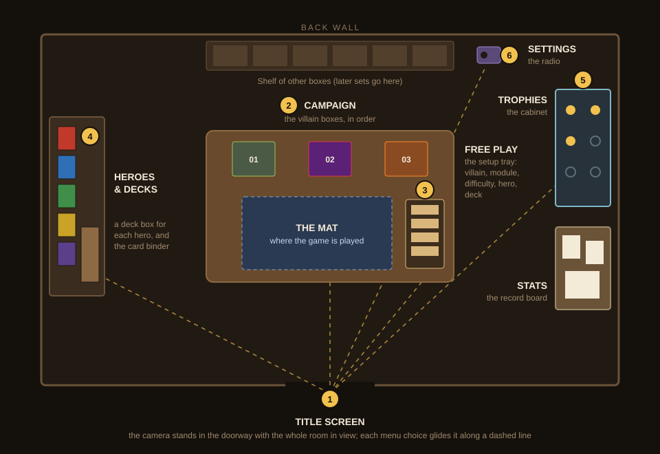

# The room: title screen, menus, heroes and deck building (plan)

_Adam asked for this on 2026-11-24 and said yes to it the same day, with the four assumed answers in "Adam's calls".
It is being built as separate tasks running side by side: "Who is building what" below says which task owns which
files. The session that wrote this plan keeps this document; a task reports what landed and does not edit it._

## The idea

The whole front of the game is one room. There is no menu screen: every menu choice is a place in the room, and
choosing it glides the camera there. The room is the one the campaign shelf already draws (a dim, warm games room: a
wooden table under a lamp, a shelf of game boxes on the back wall), grown to hold the other places.

| Stop | Menu choice      | What is there                                                                         | What you do there                                                                              |
| ---- | ---------------- | ------------------------------------------------------------------------------------- | ---------------------------------------------------------------------------------------------- |
| 1    | Title            | The doorway: the whole room in view, the game's name, your name and rank              | Press any button, then pick from the menu. Pointing at a choice leans the camera towards it.   |
| 2    | Campaign         | The villain boxes on the table (built already)                                        | Play the villains in order. A beaten box gets a stamp; a locked one says how to open it.       |
| 3    | Free Play        | A setup tray on the table: a slot each for villain, module, difficulty, hero and deck | Build any game from what you have unlocked, then Play: the pieces fly onto the mat as now.     |
| 4    | Heroes & Decks   | A bench on the left wall: a deck box per hero and a card binder                       | Pick a hero, pick or build a deck for them.                                                    |
| 5    | Trophies & Stats | A glass cabinet and a record board on the right wall                                  | See every achievement (earned ones lit, the rest in outline, each saying how) and your record. |
| 6    | Settings         | The radio on the shelf                                                                | Sound, music, controller, which side the card panel sits.                                      |
| -    | (Play)           | The mat                                                                               | The camera drops to the table and the game is dealt, as today.                                 |

How it behaves:

- Back (Escape, B on a pad) always goes one step back towards the doorway. Quitting a game returns to the doorway.
- The room shows your progress: stamps on beaten boxes, trophies filling the cabinet, the mat you chose lying on the
  table, a deck box for each hero you have. A new player's room looks bare; it fills up.
- Every choice is a real button laid over the 3D picture (as the shelf's are), so mouse, touch, keyboard and
  controller all work with the table's existing controller code, and a screen reader can read the menu.
- With "reduce motion" switched on, the camera fades between places instead of gliding.
- The look is our own design. The other games Adam remembers that move through a room are the pattern, not a model
  to copy.

## Campaign and Free Play

The Core Set has no printed campaign: it has three villains, five modules and two difficulties.

- **Campaign** is the path we already have: Rhino, then Klaw, then Ultron, each with its recommended module (Bomb
  Scare, Masters of Evil, Under Attack), on Standard. Beating all three opens the same path on Expert.
- **Free Play** is "build your own game": any villain you have beaten in the campaign, any of the five modules
  (adding Legions of Hydra and The Doomsday Chair), Standard or Expert, any hero and deck you have.
- Stringing your own villains into a campaign of your own is parked until the above is in.

The rules side can already do all of this (`coreScenario` takes `difficulty` and `modularSetIds`; the engine tests
play Expert Rhino). The 3D table can't yet: it always deals Standard with the recommended module, and has never shown the
Expert set's cards or the two other modules. Each of those needs the same card-by-card look the villains had.

## Heroes

Today the 3D table plays one hero, Spider-Man, with his Justice starter deck. The rules side already has all five
Core Set heroes and their starter decks:

| Hero           | Starter aspect | What it adds to the table's card pool               |
| -------------- | -------------- | --------------------------------------------------- |
| Spider-Man     | Justice        | In now                                              |
| Captain Marvel | Leadership     | Her 15 cards, her nemesis set, the Leadership cards |
| She-Hulk       | Aggression     | Her 15 cards, her nemesis set, the Aggression cards |
| Black Panther  | Protection     | His 15 cards, his nemesis set, the Protection cards |
| Iron Man       | Aggression     | His 15 cards, his nemesis set                       |

"A hero is in" means what it meant for Spider-Man: every card of theirs has been played on the 3D table and looks and
reads right (`deck-audit-player.test.ts` is that check for Spider-Man, 78 tests), their nemesis set too, and nothing
in the table's own code still assumes Spider-Man (the matchup title, the saved record and the deal in `model.ts`
name him today). The order above brings in a new aspect with each of the first three, so the whole Core Set card
pool is on the table after Black Panther: each starter deck holds every card of its aspect and all 11 basic cards
(checked against `starterDecks.ts` on 2026-11-24; the 44 aspect and basic cards are all in one starter or another).

The first new hero is the measure: how long Captain Marvel takes tells us how long the other three will. No estimate
before then.

## Deck building

The rules (Rules Reference v1.8, Appendix I, p. 50; checked by the rules-expert agent on 2026-11-24):

- 40 to 50 cards. The hero's own 15 cards are fixed (all of them, none swapped) and count towards the total.
- One aspect, plus basic cards.
- Up to 3 copies of a card by title, fewer where the card says so (the four "Power of" cards: 2; Energy, Genius,
  Strength: 1). No two copies of a unique card.
- How many copies come in one box is not a rule, so the builder doesn't limit by it.
- The obligation and the nemesis set are not part of the deck.

The engine already checks every one of these (`validateDeck` in `packages/engine/src/deck.ts`, with
`cardOfferedToDeck` and `copiesUpToLimit` to say what can still be added). The builder asks the engine and never
decides a rule itself. It is written new for the 3D table on top of those engine functions, not by importing the old
2D game's deck builder.

At the bench:

1. **Pick a hero**: the deck boxes stand in a row; the chosen one slides forward and opens.
2. **Pick a deck**: the starter deck, one of your saved decks, or New.
3. **Build**:
   - Left, the binder: pages of cards, with tabs for the hero's own cards (shown, fixed), the aspect (choose one of
     four; the binder takes its colour) and Basic.
   - Right, the deck tray: your deck grouped by kind with a count each, the total out of 40 to 50, and a small chart
     of costs and resources.
   - One line at the bottom says in plain words whether the deck is legal and, if not, the one thing to fix first.
   - Click a card to add a copy, click it in the tray to take one out; hover or focus shows it full size in the
     card panel the table already has.
   - Controller: D-pad through the binder, A add, X take out, LB/RB change tab, Y full size.
4. **Save** it under a name. It then shows as a deck box choice in Free Play and Campaign.

The builder can only offer cards the 3D table has been checked with, so it opens once all four aspects are in (after
Black Panther). Until then each hero plays their starter deck. It also makes pairings no starter deck has (Spider-Man
with Aggression), so its step ends with a few such games played through on the table.

## Achievements, stats and rewards

- **Worked out from the saved games, never stored**, the way villain unlocks already are. Nothing to farm or lose.
- **The cabinet** shows each as an object: lit when earned, an outline when not, saying how to earn it.
- **The record board** shows wins and losses by villain and by hero, fastest win, longest winning run.
- **Rewards change what you see, never how the game plays.** Mats first: the mat is drawn by code (`matPrint` in
  `table.ts`), so a new mat is cheap. Later: card sleeves, tokens, things that appear in the room.
- A small "Achievement unlocked" pop-up at the table when one is earned.

A first list, Core Set only (names to be written with Adam):

| Family     | Achievements                                                                                      | Reward idea                 |
| ---------- | ------------------------------------------------------------------------------------------------- | --------------------------- |
| Villains   | Beat each villain (3); beat all three; each on Expert (3); all on Expert                          | That villain's mat          |
| Heroes     | Win with each hero (5); win with each aspect (4); every hero against every villain (15 stamps)    | That hero's mat             |
| Modules    | Win with each of the five modules                                                                 | A room decoration           |
| Decks      | Win with a deck you built; win with a 50-card deck                                                | A deck box style            |
| Feats      | Win on 1 hit point; win in 5 rounds or fewer; win without playing an ally; win without using Undo | Token styles                |
| For trying | Lose 10 games; lose in round 1; lose to the scheme 5 times                                        | Something silly in the room |

[docs/achievements.md](../achievements.md) is the old 2D game's design for the same thing: a good source of families
and names, not a plan we are bound to.

**Two things to do early, because games played before them can't count:**

1. A saved game today records hero, villain, result, reason, rounds, deck and version. Add: difficulty, modules, the
   hero's hit points and form at the end, allies played, whether Undo was used, and which card dealt the last blow.
   The old 2D game already works most of this out from the finished game (`packages/client/src/engine/game-summary.ts`,
   pure code): the table takes its own copy of what it needs, as the controller did, not a new import. The test
   site's `games` table is already live and is only created when missing, so the new facts go in one added column
   (a block of JSON) with a step that adds it to the live database, not in a changed table definition.
2. Games are only saved on the test site (its database). Adam's own table saves nothing, so his cabinet would be
   empty. Give the table one "record" with two homes: the test site's database for friends, this browser's storage
   on Adam's table. Saved decks use the same two homes.

## The order to build it, and the versions

Ordered by what depends on what. The room, Free Play and trophies need only Spider-Man. The deck builder needs every
Core Set player card on the table first, so the heroes come before it.

| Version | What goes in                                                                                                                                                                                                    | Needs |
| ------- | --------------------------------------------------------------------------------------------------------------------------------------------------------------------------------------------------------------- | ----- |
| 0.3.0   | **The room.** Title in the doorway, the camera gliding between places, Campaign on the shelf, Settings on the radio. Saved games start recording the extra facts, and Adam's own table starts keeping a record. | -     |
| 0.4.0   | **Free Play.** The setup tray; Expert; the two other modules.                                                                                                                                                   | 0.3.0 |
| 0.5.0   | **Trophies & Stats.** The cabinet, the record board, the first achievements, the pop-up, the first mats.                                                                                                        | 0.3.0 |
| 0.6.0   | **Captain Marvel**, and choosing a hero at the bench (starter decks only).                                                                                                                                      | 0.3.0 |
| 0.7.0   | **She-Hulk.**                                                                                                                                                                                                   | 0.6.0 |
| 0.8.0   | **Black Panther.** The whole Core Set card pool is now on the table.                                                                                                                                            | 0.6.0 |
| 0.9.0   | **The deck builder**, and saved decks.                                                                                                                                                                          | 0.8.0 |
| 1.0.0   | **Iron Man.** Core Set complete: five heroes, three villains, five modules, Expert, deck building.                                                                                                              | 0.6.0 |

- The heroes touch different files from the room (the heroes are mostly `model.ts`, the table's card handling and
  tests; the room is the shelf's files), so a hero and a room step can be built at the same time as separate tasks.
  Both touch `main.ts`: check nobody else is mid-edit there.
- Adam's daily fixes go on as now and bump the last number. The numbers above are what the friend site gets.
- A change to the numbering, for Adam to accept: until now the middle number went up only for a new hero or villain.
  Here the room, Free Play and Trophies each take one too, so that 1.0.0 still lands on "Core Set complete".

How the room is built (for whoever builds 0.3.0):

- Grow the shelf's own scene; don't add another renderer. `boxes/boxes.ts` (1,569 lines) already has the room, the
  lights and a camera that eases between three views (`CAM_SHELF`, `CAM_OPEN`, `CAM_GAME`). First move it, unchanged,
  into a `room/` folder split into the room itself, the camera and one file per place; then add places.
- Each place is a camera position and aim, the things standing there, and its buttons. `?room=trophies` (like
  today's `?open=klaw`) jumps straight to a place for checks and screenshots.
- Draw only what is in view, and build a place's things the first time the camera heads there, so the title appears
  fast on a phone.
- A browser test with `battle` in its name walks the room with keyboard and controller.

## Where it has got to (25 Nov 2026, after round two)

| Step  | What                    | State                                                                                                                                                              | Pull requests                          |
| ----- | ----------------------- | ------------------------------------------------------------------------------------------------------------------------------------------------------------------ | -------------------------------------- |
| 0.3.0 | The room and title      | In: `room/`, the title in the doorway, the menu, Campaign, the radio. Every place in the room is filled.                                                           | 127, 133, 134                          |
| 0.3.0 | The record ("do early") | In: more facts per game (one added column on the test site), a record on Adam's own table too.                                                                     | 128                                    |
| 0.4.0 | Free Play               | In: difficulty and modules in the deal, Expert and the two modules audited, the tray, three games played and their fixes.                                          | 136, 137, 138, 143, 145                |
| 0.5.0 | Trophies & Stats        | In: the cabinet with all 32 achievements, the record board, a mat for each villain beaten, chosen at the cabinet.                                                  | 128, 141, 148                          |
| 0.6.0 | Captain Marvel          | In: her deal and audit (64 tests with Leadership), played against all three villains, chosen at the bench.                                                         | 125, 131, 135                          |
| 0.7.0 | She-Hulk                | In: her deal, her audit (22 tests) and the Aggression cards' (65), played against all three villains.                                                              | 144, 147                               |
| 0.9.0 | The deck builder        | In, ahead of its turn: opened at the bench, a hero's saved decks listed and dealt in Campaign and Free Play. Justice, Leadership and Aggression are open to build. | 126, 129, 132, 140, 142, 146, 149, 150 |

Still to check, by a person or a later task:

- A real controller and a real phone in the room; how fast the title appears on a phone. Only a simulated pad and a
  phone-sized window have been tried.
- A win. About a dozen whole games were played across the tasks and all were lost, by the play and not the table. Round
  three replaces "play until one is won" with a win driven by a test, for every hero.
- The whole release check (`pnpm table:check`): nothing since 0.2.2 had been through it when round two ended. Round
  three runs it first.
- That Cloudflare's database accepts the record's column check when a version is next shipped (it falls back to adding
  the column and ignoring "already there").
- The Doomsday Chair's M.O.D.O.K. never came out in a played game: checked by tests only.

Sizing: Captain Marvel took about 3 hours and She-Hulk about 2¼, because the shared audit driver, the fuzz list and the
cost-pick screen were already there. Every problem in both was in how the table shows things (abilities a deck uses
that earlier decks never did, and wording), none in the rules engine.

## Who is building what (round three, from 25 Nov 2026)

The last building round: the two heroes left, and the "still to check" list.

| Task                                                | Owns                                                                                                                                                                             | Leaves alone                                |
| --------------------------------------------------- | -------------------------------------------------------------------------------------------------------------------------------------------------------------------------------- | ------------------------------------------- |
| Black Panther, and a driven win for every hero      | his line in `HEROES` and the fuzz list, his audit and the Protection cards', Protection in `decks/table-pool.ts`, a browser test that wins as each hero in `HEROES`              | `room/`, the Free Play tray                 |
| Iron Man                                            | his line in `HEROES` and the fuzz list, his audit, table fixes his cards need                                                                                                    | `room/`, the Free Play tray, `decks/`       |
| The release check, then the Stampede banner         | running `pnpm table:check` on the main line and fixing what fails (any file, small fixes); the reveal banner that names the wrong card's owner (`model.ts`)                      | new features                                |
| The room: everything open on Adam's table, the tray | the gate override and "see it as a friend" switch, the chosen mat on the room's table, `room/places/free-play.ts` (hero piece from `HEROES`, several modules), the record's line | `model.ts`, the hero audits, `unlockedFrom` |

- Each hero task lands its one line in `HEROES` and in the fuzz list as its own tiny pull request first, then adds to
  the shared audit driver without restructuring it.
- `main.ts`, `model.ts` and `table.ts` are shared and large: small pull requests, merged often, and the main line
  merged into the branch before each push.
- This PC (Nimbus) has 16 GB of memory and little disk: four tasks at once is the ceiling. While working, run only the
  test file being changed. Anything heavy (a push with its check, the type check, a whole test run) takes its turn
  through `bash scripts/heavy-turn.sh <command>`; `VITEST_MAX_WORKERS=3` in front of a push keeps its check inside
  the memory there is. No production builds, no kept test recordings.
- Each task previews on its own port, never 5173 (Adam's own table), and does not commit a changed
  `.claude/launch.json`.

After round three, what is left is Adam's: a look at the room on a real controller and phone, and the word to ship.
One version to the friend site would carry everything since 0.2.2; its number is his call (1.0.0 if all five heroes
are in and the release check passes).

## Adam's calls

| #   | Question                                              | This plan assumes                                                                                                                                                                                                                                 |
| --- | ----------------------------------------------------- | ------------------------------------------------------------------------------------------------------------------------------------------------------------------------------------------------------------------------------------------------- |
| 1   | What is "Campaign" for the Core Set?                  | The three villains in order, then again on Expert. Free Play is where you build your own game. Building your own campaign comes later. (Today the shelf's code calls each villain's box a "campaign"; here the campaign is the run of all three.) |
| 2   | What does the room look like?                         | The dim, warm games room the shelf already has, our own design, filling up as you earn things.                                                                                                                                                    |
| 3   | Room first or heroes first?                           | The room first (0.3.0), heroes alongside from 0.6.0, the deck builder once Black Panther is in.                                                                                                                                                   |
| 4   | Do locks apply to Adam too?                           | Friends unlock by playing. Adam's own table has everything open, with a switch to see it as a friend does.                                                                                                                                        |
| 5   | Does a Free Play or Expert win open the next villain? | Yes, as on the friend site today: any win against a villain, in any mode or difficulty, opens the next one and earns its mat. The record shows Standard and Expert apart.                                                                         |
| 6   | How many modules can Free Play add?                   | Several at once, as the rules allow.                                                                                                                                                                                                              |
